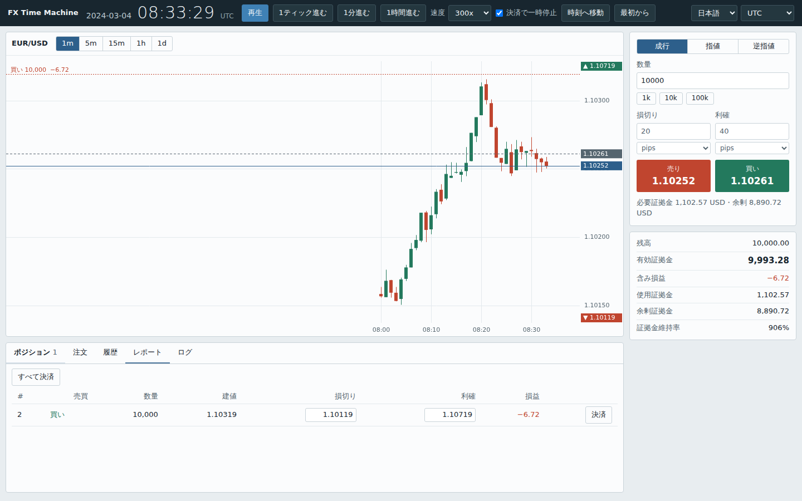

# FX Time Machine (fxtm) "FX戦士　みるくちゃん"

過去の任意の時点の為替相場を再現し、仮想のお金で売買を練習できるソフトです。無料、MITライセンス、登録不要で、自分のPCだけで動きます。データを一度ダウンロードすれば、オフラインでも使えます。

[English README](README.md)



*スクリーンショットは生成したデモデータです。実際の価格ではありません。*

## できること

- 通貨ペアと期間 (例: 2015年1月15日のEUR/CHF) を選び、ティック単位で相場の動きを再現します。
- 成行・指値・逆指値、損切り・利確、レバレッジ、ロスカットを使って売買を試せます。
- 損益を口座通貨で表示し、資金推移、最大ドローダウン、勝率を確認できます。
- スプレッド、スリッページ、レバレッジを変えて、同じ取引の結果を比べられます。
- 未来は見えません。形成中のローソク足には、再生時刻までのティックしか含まれません。

学習・研究用です。実際の注文を出す機能はありません。

## インストール

Python 3.10以上が必要です。

**WindowsとLinuxのどちらでも、プロジェクト専用の仮想環境を作って使用することをおすすめします。** 仮想環境を使うと、他のPythonプログラムとのライブラリの競合を避けられます。

初回のみ、以下の手順でインストールしてください。

### 1. プログラムを入手する

Gitを使う場合は、次のコマンドでリポジトリを取得します。

```bash
git clone <このリポジトリ>
cd fxtm
```

Gitを使わない場合は、配布されたZIPファイルを展開し、ターミナルでその中の `fxtm` フォルダに移動してください。

### 2. Windowsで仮想環境を作る

PowerShellまたはコマンドプロンプトを開き、`fxtm` フォルダに移動してから実行します。

Pythonのインストールを確認します。

```powershell
py -3 --version
```

仮想環境を作成します。

```powershell
py -3 -m venv .venv
```

#### PowerShellの場合

```powershell
.\.venv\Scripts\Activate.ps1
```

#### コマンドプロンプト (cmd) の場合

```bat
.venv\Scripts\activate.bat
```

有効化すると、コマンド入力欄の先頭に `(.venv)` と表示されます。

PowerShellでスクリプトの実行が制限されて有効化できない場合は、コマンドプロンプトで上記の `activate.bat` を使ってください。

### 3. Linuxで仮想環境を作る

ターミナルを開き、`fxtm` フォルダに移動します。

Pythonと仮想環境の機能を確認します。

```bash
python3 --version
```

仮想環境を作成します。

```bash
python3 -m venv .venv
```

仮想環境を有効化します。

```bash
source .venv/bin/activate
```

`python3 -m venv .venv` でエラーが出る場合は、使用しているLinuxディストリビューションに応じて、Pythonのvenvパッケージをインストールしてください。

### 4. インストールする

WindowsとLinuxの両方で、仮想環境を有効にした状態で実行します。

```bash
python -m pip install --upgrade pip
python -m pip install .
```

これでfxtmと必要なライブラリが仮想環境にインストールされます。

### 5. 起動する

```bash
fxtm serve
```

ブラウザで次のアドレスを開きます。

<http://127.0.0.1:8765/>

通貨ペアとUTCの期間を選んで「データを読み込んで開始」を押し、再生します。

初回は、Dukascopyの公開ヒストリカルフィードからティックをこのPCにダウンロードします。2回目以降は、保存済みのデータを使います。

**注意:** 初回のダウンロードにはインターネット接続が必要です。データサーバーの障害や利用制限などでダウンロードに失敗する場合があります。

### 6. 2回目以降の起動

仮想環境は毎回作り直す必要はありません。ターミナルを開き、プロジェクトのフォルダに移動して仮想環境を有効化し、起動します。

WindowsのPowerShell:

```powershell
cd <fxtmフォルダのパス>
.\.venv\Scripts\Activate.ps1
fxtm serve
```

Windowsのコマンドプロンプト:

```bat
cd <fxtmフォルダのパス>
.venv\Scripts\activate.bat
fxtm serve
```

Linux:

```bash
cd <fxtmフォルダのパス>
source .venv/bin/activate
fxtm serve
```

終了するときは、起動したターミナルで `Ctrl+C` を押します。仮想環境を終了するには、次のコマンドを実行します。

```bash
deactivate
```

### インストールをやり直す場合

仮想環境を終了してから、プロジェクト内の `.venv` フォルダを削除し、上記の手順で作り直してください。

ソースコードを変更した場合は、仮想環境を有効にして次のコマンドを実行すると、変更内容をインストールに反映できます。

```bash
python -m pip install -e .
```

## 使い方

```bash
fxtm serve
```

ブラウザで http://127.0.0.1:8765/ が開きます。通貨ペアとUTCの期間を選んで「データを読み込んで開始」を押し、再生します。初回は、Dukascopyの公開ヒストリカルフィードからティックをこのPCにダウンロードします。2回目以降は、保存済みのデータを使います。

操作: ホイールで拡大縮小、ドラッグで移動、ダブルクリックで最新に戻る、スペースキーで再生・一時停止。データの時刻はUTCです。画面上部で、表示の時間帯 (UTC・東京・ロンドン・ニューヨーク) と言語 (日本語・英語) を切り替えられます。

そのほかのコマンド:

```bash
fxtm serve --port 9000 --no-browser     # ポート変更、ブラウザを開かない
fxtm fetch EUR/CHF 2015-01-15           # UTCの1日分をダウンロードして保存
fxtm candles EUR/CHF 2015-01-15 --tf 5m # ローソク足を表示 (--out file.csv で保存)
fxtm import export.csv EUR/CHF          # 自分でダウンロードしたティックCSVを使う
fxtm imports                            # 読み込んだデータの一覧
python -m fxtm --version
```

ダウンロードしたデータと保存した結果は、ユーザーのデータフォルダに置かれます (Linuxは `~/.local/share/fxtm`、macOSは `~/Library/Application Support/fxtm`、Windowsは `%LOCALAPPDATA%\fxtm`)。場所を変えるには、環境変数 `FXTM_DATA_DIR` か `--data-dir` を使います。

## ダウンロードがうまくいかない場合

Dukascopyの無料のヒストリカルフィードは、2026年7月以降、不安定です。複数の独立したプロジェクトが、タイムアウトやHTTP 503を報告しています。最近は、スクリプトを遮断するボット対策 (HTTP 202) の報告もあります。普通のブラウザは通ることがあります。データ形式そのものは変わっていません。fxtmは再試行し、何が起きたかを表示します。また、失敗したダウンロードを、市場が静かだった日として保存することはありません。正しく取得できた時間は、データフォルダの `raw` に保存され、失敗した時間は、何度か再試行します。それでも失敗が残る場合は、もう一度開始を押すと、続きから取得します。フィードが止まっているときは、手元のデータファイルを使ってください。

### 手元のデータファイルを使う

1. ティックをCSVに自分で書き出します。たとえば、ブラウザでDukascopyのヒストリカルデータのページから書き出すか、`dukascopy-node` を使います。時刻・Bid・Askの列があるCSVなら使えます。`Gmt time,Ask,Bid,AskVolume,BidVolume` や `timestamp,askPrice,bidPrice` のような見出しは自動で認識します。見出しがない場合は、時刻、Ask、Bid、Askの出来高、Bidの出来高の順と見なします。時刻は、ISO形式、`15.01.2015 09:30:00.123` 形式、エポック秒・ミリ秒に対応しています。
2. ブラウザ画面の「手元のデータファイルを使う」を開き、ファイルを選んで、ファイル内の時刻の時間帯を指定し (書き出しで別の設定をしていなければUTC)、「上の通貨ペアとして読み込む」を押します。コマンドでも読み込めます。

   ```bash
   fxtm import export.csv EUR/CHF --timezone UTC
   fxtm imports                      # 読み込んだデータの一覧
   ```
3. 「読み込んだデータを使う」にチェックを入れて開始します (読み込んだデータの欄をクリックすると、通貨ペアと期間が自動で入ります)。

読み込んだファイルはこのPCの中だけに保存され、どこにも送信されません。ダウンロードしたデータとは別に管理されます。口座通貨が通貨ペアの決済通貨と違う場合は、換算用の通貨ペア (たとえばCHF/JPY) も読み込むか、「取引条件」で固定の換算レートを入力してください。

## シミュレーションのルール

| 項目 | ルール |
| --- | --- |
| 約定 | 買いはAsk、売りはBidで約定します。ロングの決済はBid、ショートの決済はAskです。 |
| 逆指値・損切り | 価格がその水準を越えた最初の気配値で約定します。価格が飛んだ場合は、飛んだ先の不利な価格になります。 |
| 指値・利確 | 触れた時点で、その価格で約定します。すでに約定可能な指値は、現在の気配値で約定します。 |
| スリッページ・遅延 | 任意で設定できます。スリッページは常に不利な方向に働き、遅延は成行注文の約定を遅らせます。 |
| 証拠金 | 数量 × 中値 × 換算レート ÷ レバレッジです。有効証拠金 = 残高 + 含み損益です。 |
| ロスカット | 有効証拠金 ÷ 使用証拠金が設定値を下回ると、含み損が最大のポジションから順に決済します。 |
| 通貨の換算 | 決済通貨建ての損益は、換算用の通貨ペアの実際の価格で換算します (円口座でEUR/CHFを取引するならCHF/JPY)。固定レートも指定できます。 |
| ポジション | 約定ごとに独立したポジションになります (両建て可)。ネッティングはしません。 |
| 時刻 | 内部はすべてUTCです。日足は00:00 UTCで区切ります。 |

同じティックと同じ注文からは、常に同じ結果が出ます。

## データと法的な注意

- コードはMITライセンスです (`LICENSE`を参照)。**市場データはこれに含まれません。**データは提供元のものであり、提供元の利用条件に従います。
- fxtmはデータを同梱も再配布もしません。あなたのPCが、Dukascopyの公開ヒストリカルフィードから直接ダウンロードして、ローカルに保存します。利用する前に、Dukascopyの最新の利用規約を確認してください。ダウンロードしたファイルを公開しないでください。
- このフィードは公式のAPIではなく、仕様が変わったり終了したりする可能性があります。データの取得部分は差し替えられる設計です (`fxtm/providers.py`)。
- fxtmは、Dukascopyとは無関係で、同社の承認も受けていません。
- シミュレーションの結果は、実際の結果ではありません。スプレッド、約定、価格の飛び、流動性は、業者やデータ提供元によって異なり、相場急変時は特に大きく違います。投資の助言ではありません。
- テレメトリはありません。ユーザーが始めたダウンロード以外、どこにも通信しません。ブラウザ画面は `127.0.0.1` だけで待ち受けます。

## 制限

- スワップと手数料は未対応です。コストはスプレッドだけです。
- セッションは先にしか進みません。戻るには「最初から」を使います (建玉と取引は破棄されるので、必要なら先に保存してください)。
- 1回のセッションで扱えるのは、最大7日分のティックです。
- 価格は小数5桁 (JPYの場合は3桁) です。金などの銘柄は未対応です。
- Dukascopyのデータの有無は、通貨ペアと日付によります。週末や休日にはティックがありません。
- オンラインのフィードは、現在不安定です (「ダウンロードがうまくいかない場合」を参照)。このプロジェクトのテストは疑似データを使うため、公開前に、実際のフィードを手で確認します。

## 開発

```bash
pip install -e .
python -m unittest discover -s tests -v
```

`CONTRIBUTING.md` も参照してください。

## ライセンス

MIT。`LICENSE` を参照してください。
